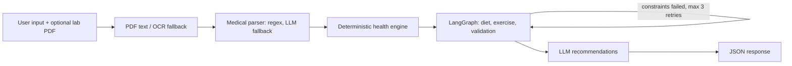
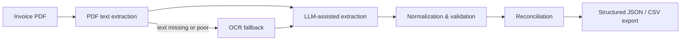

<p align="center">
  
</p>

<p align="center">
  <a href="https://github.com/MrJarvisOp"></a>
  <a href="https://linkedin.com/in/mrjarvisop"></a>
  <a href="mailto:vkvivek0338@gmail.com"></a>
</p>

---

## About

> I build intelligent software systems that combine AI, data pipelines, and reliable backend engineering to solve practical problems.

Software Engineer with 2+ years of experience building Python backends and applied AI systems: invoice and document processing, LLM workflows, RAG pipelines, and agent orchestration. I focus on structured outputs, validation of LLM results, and service designs that stay maintainable.

```text
role      : Software Engineer @ Chetu, Inc.
education : BCA, St. Andrews Institute of Technology & Management (2021 - 2024)
location  : Noida, Uttar Pradesh, India
focus     : LLM workflows, document intelligence, RAG, agent orchestration
```

---

## Experience

| Period | Role | Organization |
|:--|:--|:--|
| Apr 2025 - Present | **Software Engineer** | Chetu, Inc., Noida |
| Feb 2024 - Apr 2025 | **Software Engineer Trainee** | Chetu, Inc., Noida |

<details>
<summary>Software Engineer (Apr 2025 - Present)</summary>

- Develop Python backend services and REST APIs for enterprise AI workflows, with emphasis on structured processing, validation, and maintainable integrations.
- Utility invoice platform (confidential client): document extraction, structured JSON responses, validation, reconciliation, and CSV exports.
- Hybrid extraction flow combining PDF text extraction, OCR fallback, and LLM-assisted parsing for varied invoice layouts.
- Normalization and validation of billing periods, meter readings, service-level fields, and financial values; classification of charges, taxes, and adjustments.
- Invoice boundary and consolidation logic to keep service/invoice separation in multi-service documents.
- Meeting-transcript API using Azure OpenAI: summaries, decisions, action items, formatted PDFs, stored in client-specific Azure Blob containers.
- Contributed to a budget-forecasting AI agent and Azure AI RAG workflows.

</details>

<details>
<summary>Software Engineer Trainee (Feb 2024 - Apr 2025)</summary>

- Built Django / DRF features for an agriculture equipment sales platform: catalog, inventory, order management, coupons, authentication, OTP verification.
- Built an LLM chatbot with LangChain: tool calling, multi-session history, FAQ knowledge retrieval, reminders.
- Integrated Stripe and Razorpay payment gateways.
- Designed PostgreSQL schemas and ORM models and optimized queries.

</details>

---

## Technical Focus

| Area | Technologies |
|:--|:--|
| **AI / LLM Engineering** | Azure OpenAI, Azure AI, LangChain, LangGraph, prompt engineering, AI agents |
| **Retrieval & Document Intelligence** | RAG, embeddings, PDF text extraction, OCR, AWS Textract, structured extraction |
| **Languages & Backend** | Python, SQL, JavaScript, FastAPI, Django, DRF, Flask, Pydantic, REST API design |
| **Data & Storage** | PostgreSQL, Django ORM, AWS S3, Azure Blob Storage |
| **Tooling** | Git, GitHub, Jupyter Notebook, Azure cloud services, workflow automation |

---

## Featured Projects

Most of my professional work was delivered for enterprise clients, so the code is private. The rows without a link describe what I built, not client data.

| Project | What it does | Stack | Status |
|:--|:--|:--|:--|
| [**NutriCore-AI**](https://github.com/MrJarvisOp/NutriCore-AI) | FastAPI service that turns user biometrics and an optional lab-report PDF into diet and exercise plans. Calculations and medical flags are deterministic; the LLM only writes recommendations, and a LangGraph validation node retries plan generation up to 3 times. | Python, FastAPI, LangGraph, Groq (LLaMA 3), PyMuPDF, Tesseract OCR, SQLAlchemy | Public repo |
| **Utility Invoice Extraction Platform** | Extracts, validates, and reconciles utility invoice data into structured JSON and CSV using PDF text, OCR fallback, and LLM parsing. | Python, FastAPI, PostgreSQL, OCR, LLMs, AWS S3 | Client delivery (private) |
| **Azure AI RAG Document Pipeline** | Retrieves relevant document context for grounded LLM question answering. | Azure AI, Azure OpenAI, embeddings | Enterprise workflow (private) |
| **Meeting Transcript Processing API** | Summarizes MS Teams transcripts into topics, decisions, and action items, generates PDFs, stores them in Azure Blob. | Python, FastAPI, Azure OpenAI, ReportLab, Pydantic | Client delivery (private) |
| **Budget Forecasting AI Agent** | Multi-step agent workflow for budget and financial analysis with tool integrations. | Python, FastAPI, Azure AI, agent orchestration | Enterprise workflow (private) |
| **Ultron - Personal AI Workspace** | Personal workspace combining model access, developer tools, and automation in one interface. | Python, LLM providers, tools | In progress (not public) |

Also: a notebook-based **voice cloning prototype** (F5-TTS) and an **LLM chatbot with tool calling** (Django, LangChain, PostgreSQL).

### NutriCore-AI pipeline



### Example flow: hybrid invoice extraction



---

## Engineering Principles

```text
- Build useful systems, not just demos.
- Prefer measurable results over unsupported claims.
- Design for maintainability and reliability.
- Document architectural trade-offs.
- Validate AI output instead of trusting it blindly.
```

---

## Education & Certifications

**BCA** - St. Andrews Institute of Technology & Management (2021 - 2024)

<details>
<summary>Udemy certifications</summary>

- Machine Learning From Basic to Advanced
- Data Science Masterclass: Hands-on ML & AI Projects
- AI for Finance: Financial Modeling with Generative AI 2026
- Artificial Intelligence in App Creation: Beginners Edition
- Python App Development Masterclass: App Development Bootcamp
- Python Programming for Beginners (Hindi)
- Javascript Practicals Crash Course

</details>

---

## GitHub Stats

<table align="center">
  <tr>
    <td align="center" width="50%">
      
    </td>
    <td align="center" width="50%">
      
    </td>
  </tr>
  <tr>
    <td align="center" colspan="2">
      
    </td>
  </tr>
</table>

---

<p align="center">
  
</p>
